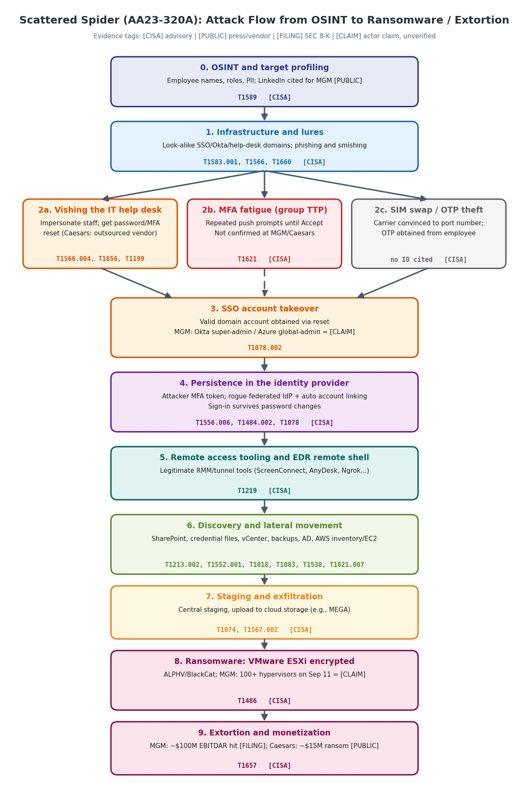

# From CTI to SOC Investigation and MITRE ATT&CK Mapping

**Course:** AI-Enhanced Cybersecurity

**Topic:** Scattered Spider social-engineering intrusions against Las Vegas hospitality operators (MGM Resorts / Caesars Entertainment, September 2023)

**Primary CTI source:** CISA/FBI Joint Cybersecurity Advisory AA23-320A, "Scattered Spider"

## Group Members

| Role | Name |
| --- | --- |
| Partner 1 |  EFIM  KARANT  |
| Partner 2 | DANIEL PINHAS |

---

## Section 1: CTI Report Information

| Field | Details |
| --- | --- |
| **Report title** | Scattered Spider (Joint Cybersecurity Advisory AA23-320A) |
| **Publisher / authors** | Federal Bureau of Investigation (FBI) and Cybersecurity and Infrastructure Security Agency (CISA). The July 2025 update is co-sealed by RCMP, ASD's ACSC, AFP, CCCS, and NCSC-UK. |
| **Product ID** | AA23-320A |
| **Publication date** | November 16, 2023 (initial version) |
| **Revisions** | November 21, 2023 (password recommendation language); July 29, 2025 (new TTPs, updated tooling, ransomware and domain lists) |
| **Direct URL (HTML)** | <https://www.cisa.gov/news-events/cybersecurity-advisories/aa23-320a> |
| **Direct URL (original PDF, Nov 2023)** | <https://www.cisa.gov/sites/default/files/2023-11/aa23-320a_scattered_spider_0.pdf> |
| **Direct URL (updated PDF, Jul 2025)** | <https://www.ic3.gov/CSA/2025/250729.pdf> |
| **Threat actor** | Scattered Spider (aliases listed by CISA include UNC3944, Octo Tempest, Oktapus, Scatter Swine, Muddled Libra); MITRE group G1015 |
| **ATT&CK version used in this report** | MITRE ATT&CK Enterprise **v16**. Note: the advisory's own mapping uses v14 (Nov 2023 version) and v17 (Jul 2025 update). All IDs below were checked for v16 on <https://attack.mitre.org/>. |

**Recommended citation (APA 7):**

> Federal Bureau of Investigation, & Cybersecurity and Infrastructure Security Agency. (2023, November 16; updated 2025, July 29). *Scattered Spider* (Joint Cybersecurity Advisory AA23-320A). CISA. https://www.cisa.gov/news-events/cybersecurity-advisories/aa23-320a (accessed October 23, 2026).

**Scope note on sources.** AA23-320A describes the group's TTPs and does **not** name MGM or Caesars as victims. Incident-specific facts in this report (MGM and Caesars) come from the companies' SEC Form 8-K filings and from public reporting, and are labeled accordingly. Evidence tags used throughout:

| Tag | Meaning |
| --- | --- |
| `[CISA]` | Stated in advisory AA23-320A (group TTP, not necessarily confirmed at a named victim) |
| `[FILING]` | Stated by the victim company in an SEC filing |
| `[PUBLIC]` | Reported by credible press or vendors (not confirmed by the victim) |
| `[CLAIM]` | Claimed by the threat actor; not independently verified |
| `[HUNT]` | Analyst hypothesis for investigation; not evidence |

---

## Section 2: Attack Summary & Objective

In September 2023, the Scattered Spider group (UNC3944, Octo Tempest) compromised Las Vegas hospitality operators MGM Resorts and Caesars Entertainment. The FBI/CISA advisory AA23-320A describes the group's playbook: open-source research on employees, then vishing and smishing that impersonate staff and persuade IT help desks, including outsourced ones, to reset passwords and MFA factors. CISA also lists MFA fatigue (repeated push prompts) as a group technique, although reporting on MGM centers on a help-desk call. The ALPHV/BlackCat gang claimed, without MGM's confirmation, Okta super-administrator and Azure global-administrator access at MGM. The advisory documents registration of attacker-controlled MFA tokens, a rogue federated identity provider, and legitimate remote access tools for persistence. ALPHV claimed that it encrypted more than 100 VMware ESXi hypervisors at MGM on September 11. MGM later estimated a hit of roughly $100 million to adjusted property EBITDAR plus under $10 million in one-time costs. Hotel occupancy at MGM fell to 88% in September versus 93% a year earlier. Caesars disclosed theft of its loyalty database and reportedly paid about $15 million.

*(Word count: approximately 172.)*

**Objective of the actor.** Financial gain through data theft, extortion, and ransomware `[CISA]`.

---

## Section 3: Attack Flow Diagram

---

## Section 4: Tactics, Techniques, and Observed Behaviors

Five behaviors are analyzed. For each, the evidence is separated into what the advisory states about the group and what is known about MGM/Caesars specifically.

### Behavior 1: Vishing of the IT help desk (voice social engineering)

- **Tactics:** Initial Access, Defense Evasion
- **Techniques:** T1566.004 (Phishing: Spearphishing Voice), T1656 (Impersonation), T1199 (Trusted Relationship), T1078.002 (Valid Accounts: Domain Accounts)
- **What the advisory states `[CISA]`:** The actors pose as company IT or help-desk staff by phone or SMS, and use voice communication to convince help-desk personnel to reset passwords and/or MFA tokens, then take over accounts in SSO environments. The advisory also states the group abuses the trusted relationship of contracted IT help desks.
- **MGM / Caesars specifics:** For MGM, press and vendor reports describe an employee identity found on LinkedIn, followed by a short help-desk call `[PUBLIC]`; MGM itself has not published the technical details. Caesars stated in its Form 8-K that the intrusion resulted from a social engineering attack on an **outsourced IT support vendor** `[FILING]`. Okta separately warned in August 2023 that US customers were facing help-desk calls aimed at resetting MFA factors of highly privileged users `[PUBLIC]`.
- **Why it matters:** The attacker uses a legitimate business process (credential reset) and a human verification step, so no malware or exploit is needed.

### Behavior 2: MFA request generation (MFA fatigue / push bombing)

- **Tactic:** Credential Access
- **Technique:** T1621 (Multi-Factor Authentication Request Generation)
- **What the advisory states `[CISA]`:** The actors send repeated MFA notification prompts until an employee presses "Accept," and CISA maps this to T1621.
- **MGM / Caesars specifics:** Public reporting on MGM and Caesars centers on help-desk resets, not push bombing. **MFA fatigue is a documented group TTP, not a confirmed step in the MGM or Caesars intrusions.** It is included because the advisory lists it as a path to the same outcome (an authenticated session) and it requires a different detection strategy from Behavior 1.
- **Why it matters:** Push-based MFA is bypassed through user behavior rather than a technical flaw. CISA recommends phishing-resistant MFA (FIDO/WebAuthn) because it is not susceptible to push bombing or SIM swapping.

### Behavior 3: Modification of the authentication process (attacker MFA, federated IdP)

- **Tactics:** Persistence, Credential Access, Defense Evasion, Privilege Escalation
- **Techniques:** T1556.006 (Modify Authentication Process: Multi-Factor Authentication), T1484.002 (Domain Policy Modification: Domain Trust Modification), T1078 (Valid Accounts); related: T1606 (Forge Web Credentials)
- **What the advisory states `[CISA]`:** After compromising a user's account, the actors register their own MFA tokens to persist. They add a federated identity provider to the victim's SSO tenant and activate automatic account linking, which lets them sign in to any account by matching an SSO attribute and keep logging in even when passwords are changed.
- **MGM specifics:** ALPHV claimed it held Okta super-administrator privileges and Azure global-administrator permissions at MGM and had been present on Okta agent servers `[CLAIM]`. Okta stated that its own systems were not compromised and that it was supporting MGM `[PUBLIC]`. MGM has not confirmed the claim.
- **Why it matters:** Once the identity provider is controlled, the attacker can authenticate as nearly any user, and password resets alone do not evict them.

### Behavior 4: Use of legitimate remote access software and EDR remote shells

- **Tactics:** Command and Control, Persistence
- **Technique:** T1219 (Remote Access Software). In ATT&CK v16 this technique has no sub-techniques (sub-techniques were introduced in v17).
- **What the advisory states `[CISA]`:** Impersonating help-desk staff, the actors direct employees to run commercial remote access tools. After gaining access, the FBI observed repurposed legitimate tools (e.g., Fleetdeck.io, Level.io, Pulseway, ScreenConnect, Splashtop, Tactical.RMM, Tailscale, TeamViewer, Ngrok), and the actors use EDR tools' remote-shell capabilities to execute commands. CISA notes that use of these legitimate tools alone does not indicate criminal activity.
- **MGM / Caesars specifics:** The specific tools used at MGM and Caesars are **not publicly confirmed**. The behavior is mapped from the advisory's group-level evidence.
- **Why it matters:** Allowlisted, signed, legitimate software blends in with normal IT administration, which makes behavior and context (who installed it, from where, when) the key detection signals.

### Behavior 5: Data encrypted for impact on VMware ESXi hypervisors

- **Tactic:** Impact
- **Technique:** T1486 (Data Encrypted for Impact); supporting: T1567.002 (Exfiltration to Cloud Storage), T1657 (Financial Theft)
- **What the advisory states `[CISA]`:** Per trusted third parties, the actors may have deployed BlackCat/ALPHV ransomware, encrypting VMware ESXi servers. The group also exfiltrates data (e.g., to MEGA[.]NZ) and extorts victims with or without encryption.
- **MGM specifics:** ALPHV claimed it launched ransomware against more than 100 ESXi hypervisors on September 11, 2023, after MGM disconnected its Okta sync servers `[CLAIM]`. MGM stated in its Form 8-K that it shut down systems to protect customer information `[FILING]`, estimated roughly $100 million negative impact on adjusted property EBITDAR plus under $10 million in one-time expenses `[FILING]`, and reported that personal data of some customers who transacted before March 2019 was obtained `[FILING]`.
- **Caesars specifics:** Caesars disclosed theft of its loyalty database `[FILING]`; major outlets reported a ransom payment of about $15 million, reduced from a $30 million demand `[PUBLIC]`.
- **Why it matters:** ESXi hosts concentrate many virtual machines, so encrypting a small number of hypervisors can stop reservations, gaming floors, and payment systems at once.

---

## Section 5: ATT&CK Mapping & SOC Investigation Table

| Observed Behavior | ATT&CK Tactic | Technique / ID | Evidence & Rationale | SOC Investigation: Tier 1 Triage and Tier 2 Investigation |
| --- | --- | --- | --- | --- |
| **1. Vishing of IT help desk** to obtain password/MFA reset (including an outsourced vendor) | Initial Access; Defense Evasion | **Phishing: Spearphishing Voice (T1566.004)** **Impersonation (T1656)** **Trusted Relationship (T1199)** **Valid Accounts: Domain Accounts (T1078.002)** | `[CISA]` Advisory maps voice communication used to convince help desks to reset passwords/MFA to T1566.004, with T1656, T1199, and T1078.002 cited in the same passage. `[FILING]` Caesars attributes its intrusion to social engineering of an outsourced IT vendor. `[PUBLIC]` MGM call details are press reports only. **Rationale:** The target is a person, the channel is voice, and the objective is access. | **Telemetry:** VoIP/UCaaS call detail records and recordings (caller ID/ANI, trunk, duration), ITSM/ticketing system, help-desk identity-verification records, Okta System Log, Entra ID audit log. **Tier 1 Triage:** Alert on a password or MFA reset for a privileged user (Okta `user.mfa.factor.reset_all`, `user.account.reset_password`; Entra "Reset password" / "User registered security info") that was initiated by help desk. Check that a ticket exists and verification was completed; call the user back on a known number. Escalate if reset was for admin/executive accounts, came from an unverified caller, or was followed by a new session from an unusual IP. **Tier 2 Investigation:** Pull the VoIP CDR and recording and match call end time to the reset event (minutes apart). Review the first sign-in after the reset (IP, ASN, user agent, device). Audit the outsourced vendor's agent activity and access logs. Look for look-alike domain lookups in DNS/proxy logs. Revoke sessions and reset factors; assess exposure of employee PII (OSINT surface). |
| **2. MFA fatigue**: repeated push prompts until acceptance (documented group TTP; not confirmed at MGM/Caesars) | Credential Access | **Multi-Factor Authentication Request Generation (T1621)** | `[CISA]` Advisory states the actors send repeated MFA prompts leading employees to accept, and maps it to T1621. **Rationale:** The behavior is request spamming against a victim with valid primary credentials. Confidence for MGM/Caesars is **low** (no public confirmation). | **Telemetry:** Okta System Log (`system.push.send_factor_verify_push`, `user.mfa.okta_verify.deny_push`, `user.authentication.auth_via_mfa`, `user.session.start`); Entra ID sign-in logs (e.g., error 500121 for failed strong authentication); VPN/SSO logs; user reports. **Tier 1 Triage:** Alert when a user receives more than N push challenges in a short window, or multiple denials followed by one approval. Contact the user: did they approve a prompt they did not initiate? Lock the account and revoke sessions if not. **Tier 2 Investigation:** Correlate the approved session with source IP/ASN/geo and device posture; check whether the same user then registers a new MFA factor (Behavior 3), creates mailbox rules, or accesses admin consoles. Hunt for the same source IP across other accounts (spraying). Recommend number matching and phishing-resistant MFA. |
| **3. Modification of authentication process**: attacker-registered MFA, federated IdP with automatic account linking, privileged IdP access | Persistence; Credential Access; Defense Evasion; Privilege Escalation | **Modify Authentication Process: Multi-Factor Authentication (T1556.006)** **Domain Policy Modification: Domain Trust Modification (T1484.002)** **Valid Accounts (T1078)** *related:* **Forge Web Credentials (T1606)** | `[CISA]` Advisory states the actors register their own MFA tokens, add a federated IdP and enable automatic account linking, and continue logging in after password changes. `[CLAIM]` ALPHV asserted Okta super-admin and Azure global-admin control at MGM (unconfirmed). **Rationale:** T1556.006 fits the MFA registration; T1484.002 fits the federation change. Both are explicitly named in the advisory. | **Telemetry:** Okta System Log (`user.mfa.factor.activate`, `user.mfa.factor.update`, `system.idp.lifecycle.create`, `user.account.privilege.grant`, `group.privilege.grant`, `policy.rule.update`); Entra ID audit log ("Add member to role" for Global Administrator, "Set federation settings on domain," "User registered security info"); admin-console access logs. **Tier 1 Triage:** Alert on any new MFA factor on a privileged account within hours of a reset or password change, on any new IdP/federation object, and on any new admin role assignment. Verify against change tickets; if none, escalate immediately as a P1 identity incident. **Tier 2 Investigation:** Build a timeline from the first reset to the persistence change. Enumerate all factors, IdPs, API tokens, OAuth apps, and admin role assignments created or modified; compare them to a known-good baseline. Review sign-ins that match on account attributes via the new IdP. Remove rogue IdP and factors, rotate sync-server and API credentials, and rebuild trust only after the tenant is verified. Treat any password reset as insufficient on its own. |
| **4. Legitimate remote access software** (RMM, tunneling, EDR remote shell) used for access and persistence | Command and Control; Persistence | **Remote Access Software (T1219)** | `[CISA]` Advisory lists the tools above, states employees are directed to run them while the actors impersonate help-desk staff, and says RMM tools are deployed to maintain persistence. `[HUNT]` Which tools were used at MGM/Caesars is not public. **Rationale:** The technique covers legitimate remote access software repurposed by an adversary; no sub-technique is assigned because v16 has none. The advisory warns that these tools alone are not proof of malicious use. | **Telemetry:** EDR process-creation and network events; Windows Event ID 4688/Sysmon 1 and 7045 (new service); DNS and proxy logs to remote-access relay domains; software inventory; application-allowlisting block events. **Tier 1 Triage:** Alert on execution or installation of any remote access tool not in the approved RMM inventory (for example ScreenConnect, AnyDesk, TeamViewer, Splashtop, Level, Pulseway, Ngrok, Tailscale), especially portable executables run from user-writable paths or launched shortly after a help-desk interaction. Check for a matching ticket; isolate the host if none. **Tier 2 Investigation:** Identify who installed the tool, the parent process, the source of the download, and the relay or tenant ID it connects to. Look for credential-access tooling such as Mimikatz (`[CISA]`, S0002) via LSASS access events, and for discovery of vCenter, backups, and AD. Check whether the EDR console itself was used for remote shell commands (EDR audit logs). Block the relay indicators and remove unauthorized agents. |
| **5. Ransomware encryption of VMware ESXi hypervisors**, preceded by data exfiltration and followed by extortion | Impact (with Exfiltration) | **Data Encrypted for Impact (T1486)** *supporting:* **Exfiltration to Cloud Storage (T1567.002)**, **Financial Theft (T1657)** | `[CISA]` Advisory states the actors may have deployed BlackCat/ALPHV ransomware, encrypting ESXi servers (T1486), exfiltrate to MEGA[.]NZ and U.S. data centers (T1567.002), and monetize via extortion (T1657). `[CLAIM]` 100+ ESXi hypervisors at MGM on September 11. `[FILING]` MGM shut down systems and quantified the financial impact. **Rationale:** Encryption of virtualization infrastructure to disrupt availability is the textbook use of T1486. | **Telemetry:** ESXi syslog forwarded to the SIEM (`shell.log`, `auth.log`, `hostd.log`, `vobd.log`, `vmkernel.log`); vCenter events (`esx.audit.ssh.enabled`, `esx.audit.shell.enabled`, `esx.audit.lockdownmode.exited`); datastore file-system changes (renamed or new extensions on `.vmdk`/`.vmx` files, ransom notes); EDR on Windows guests; VSS and backup-console events (`[HUNT]`: `vssadmin delete shadows` or backup deletion, not stated in the advisory); NetFlow/proxy for uploads to MEGA or cloud storage. **Tier 1 Triage:** Treat any of these as an immediate P1 and escalate: SSH or ESXi Shell enabled outside change windows, lockdown mode disabled, mass VM power-off, mass file renames, or ransom-note creation on datastores. Isolate the management network and affected hypervisors per the playbook; do not reboot until Tier 2 confirms evidence is preserved. **Tier 2 Investigation:** Reconstruct the path from identity compromise to hypervisor access: which account logged in to vCenter or the host, from where, and when SSH was enabled. Recover shell history, hashes, and the encryptor sample for analysis (in a sandbox only). Quantify exfiltration volume and destinations (T1567.002) and determine which datasets were taken. Verify that backups are offline and immutable, test restores before recovery, and coordinate legal/regulatory notification. |

**Mapping notes.**

- Social engineering itself is not a single ATT&CK technique. In this report it is represented by T1566.004 (voice), T1656 (impersonation), T1199 (trusted relationship), and T1621 (MFA request generation).
- SIM swapping is described by the advisory but has no ATT&CK ID cited there, so it is shown in the flow diagram without an ID.
- T1490 (Inhibit System Recovery), VSS deletion, and ESXi shell commands are **hunting hypotheses** `[HUNT]` for the SOC, not mapped behaviors, because the advisory does not state them.
- Event names for Okta, Entra ID, and ESXi should be validated against each product's documentation and the organization's log schema before building detections.

---

## Section 6: Uncertain Mapping & Alternative Interpretation Analysis

### 6.1 Uncertain mapping

**Behavior:** The social-engineering call to the IT help desk that produced a password/MFA reset.
**Current mapping:** **T1566.004 Phishing: Spearphishing Voice** (Initial Access).

**Why it is uncertain.**

1. ATT&CK has no single "social engineering" technique. The behavior can be placed under several techniques depending on the call's purpose and the attack stage.
2. The best-documented facts about the MGM call come from press reports and threat-actor claims `[PUBLIC]` `[CLAIM]`, not from MGM, CISA, or the FBI.
3. For Caesars, the 8-K states "social engineering of an outsourced IT support vendor" but does not state whether the channel was voice, chat, or email `[FILING]`.

### 6.2 Alternative interpretations

| Candidate | Tactic | When it is the better fit | Assessment |
| --- | --- | --- | --- |
| **T1566.004 Spearphishing Voice** (current) | Initial Access | The call itself delivered access, for example by tricking the help desk into resetting a credential or MFA factor. | **Best fit for the advisory text**, which maps help-desk voice calls to T1566.004. |
| **T1598.004 Phishing for Information: Spearphishing Voice** | Reconnaissance | The call only collected information (employee ID, security-question answers, account details) to be used in a later, separate step. | **Plausible for a sub-step.** The advisory lists T1598 and T1589 for the information-gathering phase, so the earlier calls or SMS may belong here. |
| **T1656 Impersonation** | Defense Evasion | Used together with another technique to describe the pretext (posing as an employee or IT staff). | **Complementary, not a replacement.** Already included in the mapping because the advisory cites it. |
| **T1199 Trusted Relationship** | Initial Access | The entry point is a third party (outsourced help desk) abused through its trusted access. | **Best fit for Caesars' vendor angle.** Complementary to T1566.004. |
| **T1565 "Social Engineering" (rejected)** | n/a | Never. | **Rejected.** T1565 is *Data Manipulation* (Impact). ATT&CK does not define a "Social Engineering" technique, so using T1565 would be a classification error. |

**Position of the team.** Keep **T1566.004** as the primary mapping, add **T1656** and **T1199** as supported secondary mappings, and treat **T1598.004** as an alternative for any call that only gathered information.

### 6.3 Evidence required to confirm or refute the mapping

| Evidence | What it would show | Effect on mapping |
| --- | --- | --- |
| VoIP/UCaaS call detail records and call recordings from the help desk (and the outsourced vendor) | A voice call occurred, its origin number, duration, and the caller's script and requests | Confirms the **voice** channel and supports T1566.004 |
| ITSM ticket and help-desk identity-verification records | Whether the agent verified identity and what was requested (reset password, reset MFA, add device) | Distinguishes access-granting action (T1566.004) from information-only contact (T1598.004) |
| Okta/Entra audit events (password reset, MFA factor reset or enrollment) with timestamps | A privileged change minutes after the call ends | Confirms the call **delivered access** (Initial Access, T1078.002) |
| Vendor audit logs (agent identity, tooling used, accounts accessed) | Whether the compromised party was the third-party help desk | Supports **T1199** (and the Caesars scenario) |
| Prior SMS/phishing messages and look-alike domain logs | Earlier information-gathering contacts | Supports T1598 / T1583.001 for the preceding stage |
| Official statement or incident report from MGM, Caesars, FBI, or CISA about the channel and sequence | Primary confirmation instead of press reports | Raises confidence from `[PUBLIC]` to `[FILING]` or `[CISA]` |
| Evidence that the channel was chat, email, or an online portal rather than voice | A non-voice pretext | **Refutes** T1566.004; use T1566.003 (Spearphishing via Service) or T1566.001/T1566.002 as appropriate |

### 6.4 Peer-Review / Discussion 

| Item | Entry |
| --- | --- |
| **Reviewing group / instructor** | DANIEL PINHAS |
| **Date of discussion** | 24/10/2026 |
| **Mapping reviewed** | Help-desk vishing: T1566.004 vs T1598.004 vs T1656/T1199 (and rejection of T1565) |
| **Question posed to the reviewer** | Is the help-desk call best classified as Initial Access (T1566.004) or as information gathering (T1598.004), given that public sources do not reveal what the caller requested? |
| **Our position before review** | T1566.004 primary; T1656 and T1199 secondary; T1598.004 only for information-only contacts; T1565 rejected as a different technique (Data Manipulation). |
| **Reviewer feedback (record verbatim summary)** | The reviewer confirmed that MITRE ATT&CK T1566.004 (Spearphishing Voice) is the correct primary technique since the social engineering attempt actively engaged the victim to achieve an initial compromise or gain credential access. T1598.004 is appropriate as secondary/informational only if data was gathered without direct exploit/reset, and T1565 was correctly rejected. |
| **Decision criteria agreed** | If the call led directly to a credential or MFA reset, keep T1566.004. If it only collected data used later, move that step to T1598.004. If the entry point was a vendor agent, add T1199. If the channel was not voice, replace T1566.004 with the matching T1566 sub-technique. |
| **Final revision of the mapping** | Unchanged. The original mapping (T1566.004 as primary) was retained as the help-desk interaction directly facilitated initial access/credential reset. |

---

## References

1. Federal Bureau of Investigation, & Cybersecurity and Infrastructure Security Agency. (2023, November 16; updated 2025, July 29). *Scattered Spider* (Joint Cybersecurity Advisory AA23-320A). <https://www.cisa.gov/news-events/cybersecurity-advisories/aa23-320a>
2. CISA/FBI. *AA23-320A Scattered Spider* (original PDF, November 2023). <https://www.cisa.gov/sites/default/files/2023-11/aa23-320a_scattered_spider_0.pdf>
3. FBI, CISA, RCMP, ASD's ACSC, AFP, CCCS, NCSC-UK. *AA23-320A Scattered Spider* (updated PDF, July 29, 2025). <https://www.ic3.gov/CSA/2025/250729.pdf>
4. MGM Resorts International. Form 8-K (event date October 5, 2023), U.S. Securities and Exchange Commission. <https://www.sec.gov/Archives/edgar/data/789570/000119312523251667/d461062d8k.htm>
5. Caesars Entertainment, Inc. Form 8-K (filed September 14, 2023), U.S. Securities and Exchange Commission. <https://www.sec.gov/Archives/edgar/data/1590895/000119312523235015/d537840d8k.htm>
6. Ilascu, I. "MGM casino's ESXi servers allegedly encrypted in ransomware attack." *BleepingComputer*, September 14, 2023. <https://www.bleepingcomputer.com/news/security/mgm-casinos-esxi-servers-allegedly-encrypted-in-ransomware-attack/>
7. "Threat actors claim to have compromised MGM's Okta environment." *Cybersecurity Dive*, September 2023. <https://www.cybersecuritydive.com/news/mgm-resorts-cyberattack/693829/>
8. "Okta: Caesars, MGM hacked in social engineering campaign." *TechTarget*, September 2023. <https://www.techtarget.com/cybersecurity/news/366552775/Okta-Caesars-MGM-hacked-in-social-engineering-campaign>
9. "Caesars says cyber-crooks stole customer data as MGM casino outage drags on." *The Register*, September 14, 2023. <https://www.theregister.com/2023/09/14/caesars_mgm_hacks>
10. "Caesars Entertainment: major breach and ransom reports." *Infosecurity Magazine*, September 2023. <https://www.infosecurity-magazine.com/news/caesars-entertainment-major/>
11. MITRE ATT&CK. Enterprise Matrix (v16). <https://attack.mitre.org/>
12. MITRE ATT&CK. Scattered Spider, Group G1015. <https://attack.mitre.org/groups/G1015/>
13. MITRE ATT&CK. *Best Practices for MITRE ATT&CK Mapping* and CTI training. <https://attack.mitre.org/resources/learn-more-about-attack/training/cti/>
