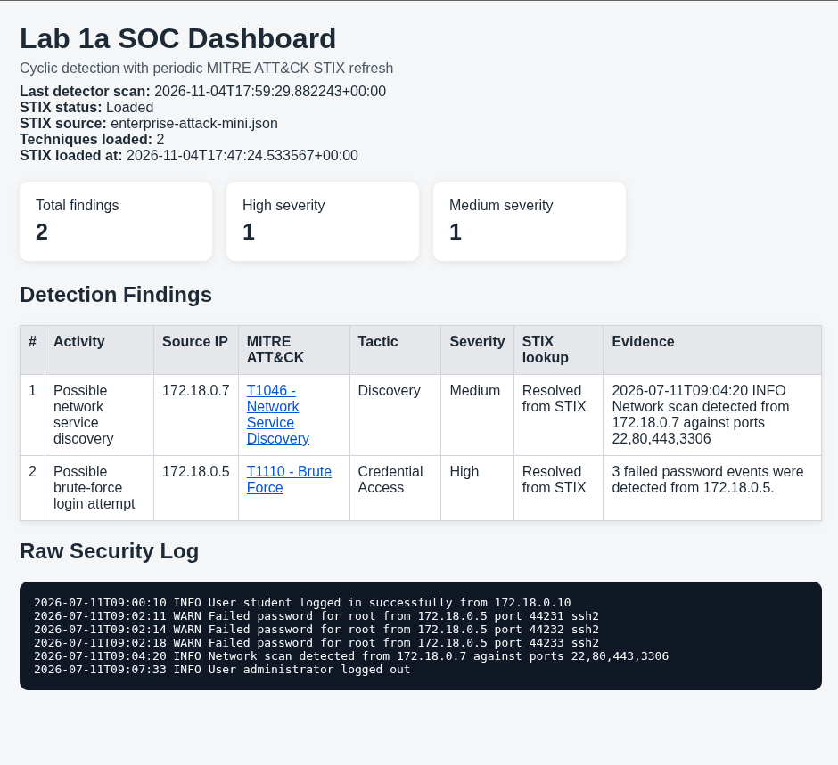
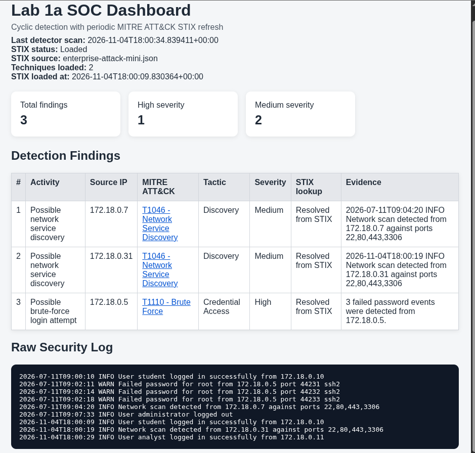

# Laboratory 1a — Rule-Based SOC Detection and MITRE ATT&CK Mapping

**Course:** AI-Enhanced Cybersecurity — Holon Institute of Technology (HIT)  
**Students:**  

| No. | Student |
| --- | --- |
| 1 | Daniel Pinhas |
| 2 | EFIM KARANT |

**Date:** November 4, 2026  
**Environment:** Pop!_OS Linux · Docker Engine 29.1.3 · Docker Compose 2.40.3  
**Source lab:** [HIT AI Cybersecurity Labs — Lab 1a](https://github.com/melofon/HIT-ai-cybersecurity-labs/tree/main/labs/lab1a-mitre-soc)

## 1. Objective and architecture

This laboratory examines how a **deterministic rule-based SOC detector** transforms raw security logs into candidate findings enriched with local MITRE ATT&CK STIX metadata. The tests used only supplied or synthetic events. No live networks were scanned and no real attacks were performed.

```text
logs/security.log → detector (rescans every ~5 s) → output/findings.json → dashboard (:8000)
                       ↑
                local MITRE STIX metadata
```

The optional `simulator` appends synthetic log events. The detector is **not an AI or LLM-based system**.

## 2. Docker verification and clean baseline

`docker compose ps` showed both services running:

| Service | Container | Observed state | Exposure |
| --- | --- | --- | --- |
| detector | `mitre-log-detector` | Up | Internal |
| dashboard | `lab1a-dashboard` | Up | `localhost:8000` |

`wc -l logs/security.log` returned **6**. The initial log was saved as `logs/security.log.bak` before experiments. The original `output/findings.json` showed:

- **`finding_count: 2`**; `scan_interval_seconds: 5`; `failed_password_threshold: 3`.
- **T1110 — Brute Force (High)** from `172.18.0.5` after three failed SSH password events.
- **T1046 — Network Service Discovery (Medium)** from `172.18.0.7` following an explicit network-scan log entry.
- `mitre_knowledge.status: "Loaded"`; both technique lookups were `Resolved from STIX`.



*Figure 1. Verified clean baseline: six raw log lines, two findings (T1046 and T1110), and two STIX techniques loaded.*

### Original evidence

**T1110 (lines 2–4):**

```text
2026-07-11T09:02:11 WARN Failed password for root from 172.18.0.5 port 44231 ssh2
2026-07-11T09:02:14 WARN Failed password for root from 172.18.0.5 port 44232 ssh2
2026-07-11T09:02:18 WARN Failed password for root from 172.18.0.5 port 44233 ssh2
```

**T1046 (line 5):**

```text
2026-07-11T09:04:20 INFO Network scan detected from 172.18.0.7 against ports 22,80,443,3306
```

## 3. Evidence → rule → MITRE technique → tactic → uncertainty

| Observed evidence | Triggering rule | Candidate technique (severity) | Tactic | Uncertainty |
| --- | --- | --- | --- | --- |
| Three `Failed password` messages from `172.18.0.5` | ≥3 failed-password records **from the same IP** | **T1110 — Brute Force (High)** | Credential Access | Failed authentications alone do not prove attacker intent or successful login. |
| `Network scan detected` entry from `172.18.0.7` | Log text contains `network scan detected` | **T1046 — Network Service Discovery (Medium)** | Discovery | The detector uses a scan *notice*, not independent packet/flow evidence; no real scan is established. |

MITRE references: [T1110](https://attack.mitre.org/techniques/T1110/) · [T1046](https://attack.mitre.org/techniques/T1046/).

## 4. Controlled experiments (C1–C4)

The simulator was stopped during controlled experiments. After each change, the detector rescanned and `output/findings.json` was inspected.

| Test | Modified log data | Prediction | Observed result | Explanation |
| --- | --- | --- | --- | --- |
| **C1 — Below threshold** | Removed the `172.18.0.5` failed-password event on port `44233`, leaving two. | 1 finding: T1046 only | **1**; T1110 disappeared, T1046 remained | Two failures do not reach the threshold of three. |
| **C2 — Different IPs** | Restored three events but used `172.18.0.5`, `.6`, and `.8` respectively. | 1 finding: T1046 only | **1**; no T1110 | Failures are grouped **per source IP**, not globally. |
| **C3 — New IP exceeds threshold** | Added three failed-password events from `192.0.2.55`. | 2 findings: existing T1046 + new T1110 | **2**; T1110 appeared for `192.0.2.55` (High) | Three events from one new IP trigger T1110. |
| **C4 — Another scan notice** | Added an explicit scan message from `192.0.2.77`. | 3 findings: two T1046 + one T1110 | **3**; T1046 for `172.18.0.7` and `192.0.2.77`; T1110 for `192.0.2.55` | Each matching scan notice causes another T1046 finding. |

**Exact added C3 lines:**

```text
2026-10-22T10:01:00Z WARN Failed password for test from 192.0.2.55 port 40001 ssh2
2026-10-22T10:01:02Z WARN Failed password for test from 192.0.2.55 port 40002 ssh2
2026-10-22T10:01:04Z WARN Failed password for test from 192.0.2.55 port 40003 ssh2
```

**Exact added C4 line:**

```text
2026-10-22T10:02:00Z INFO Network scan detected from 192.0.2.77 against ports 22,80,443
```

All four predictions matched the actual results reported by the running detector.

## 5. MITRE knowledge and simulator (Activity D)

The local file `mitre/enterprise-attack-mini.json` supplied **two STIX attack-pattern technique mappings**, both successfully resolved:

- **T1110 / Credential Access:** repeated failed authentication with a common source IP.
- **T1046 / Discovery:** explicit network service discovery notice in a log line.

In the simulator-stage dashboard screenshot, the finding count increased from **2** to **3**. Alongside the original T1110 (`172.18.0.5`) and T1046 (`172.18.0.7`), a new **T1046** candidate appeared for **`172.18.0.31`**. The raw log includes:

```text
2026-11-04T18:00:09 INFO User student logged in successfully from 172.18.0.10
2026-11-04T18:00:19 INFO Network scan detected from 172.18.0.31 against ports 22,80,443,3306
2026-11-04T18:00:29 INFO User analyst logged in successfully from 172.18.0.11
```

The screenshot shows **no additional T1110 candidate** from those newly appended records at the captured moment. The new T1046 was created by the scan-notice line, while successful-login lines did not trigger either rule. Because the simulator keeps adding input records, counts and source IPs can change between observations. This makes it less reproducible than a fixed, manually edited log.



*Figure 2. Simulator-stage snapshot: three findings (one High and two Medium), with new T1046 source IP 172.18.0.31.*

## 6. SOC narrative (126 words)

On 4 November 2026, I tested a rule-based SOC detector in Docker on Pop!_OS. The clean six-line log produced two findings: T1110 (High) after three failed SSH password events from 172.18.0.5, and T1046 (Medium) for an explicit scan notice from 172.18.0.7. In C1, removing one failure eliminated T1110. In C2, distributing failures among three source IPs also avoided the threshold. In C3, three failures from 192.0.2.55 created a new T1110. In C4, a scan notice from 192.0.2.77 added T1046, giving three findings. A later simulator screenshot showed a new T1046 for 172.18.0.31. These observations confirm how the implemented rules classify log text; they do not establish hostile intent, a real scan, successful authentication by an attacker, or compromise. Corroboration would require independent endpoint and network evidence.

## 7. Limitations, cleanup and reproducibility

- **False negatives:** two failures from one IP and distributed single failures across several IPs do not trigger T1110.
- **No time window:** the introductory T1110 rule counts matching failures without bounding them to an interval.
- **Limited evidence:** T1046 trusts a prewritten scan notice; neither rule establishes attacker identity, intent, successful access, or compromise.
- **Reproducibility:** the optional simulator appends events dynamically; for deterministic counts, restore the six-line baseline and stop the simulator.

Restore the original six-line log and stop services:

```bash
cp logs/security.log.bak logs/security.log
docker compose --profile simulation down
```

Do not commit experimental changes to the original upstream `logs/security.log`. Commit only this report and its genuine screenshot evidence to the coursework repository.
