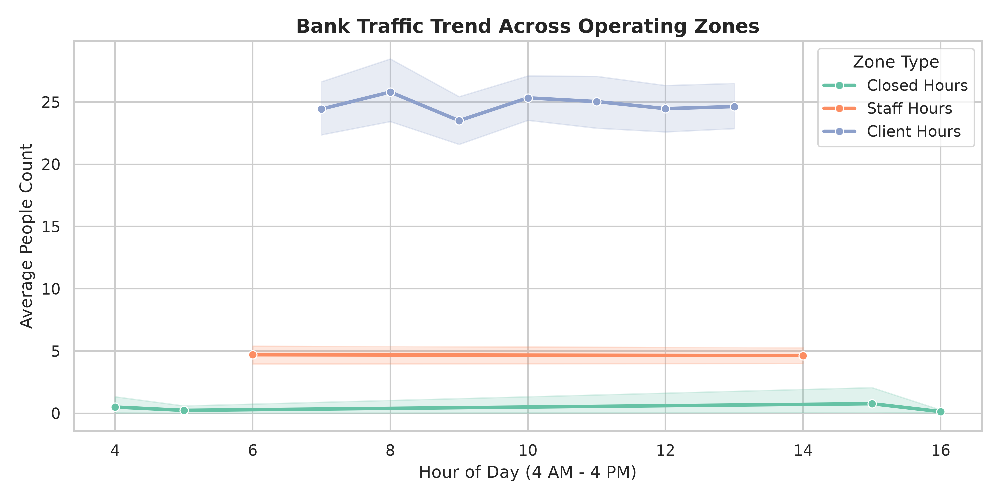
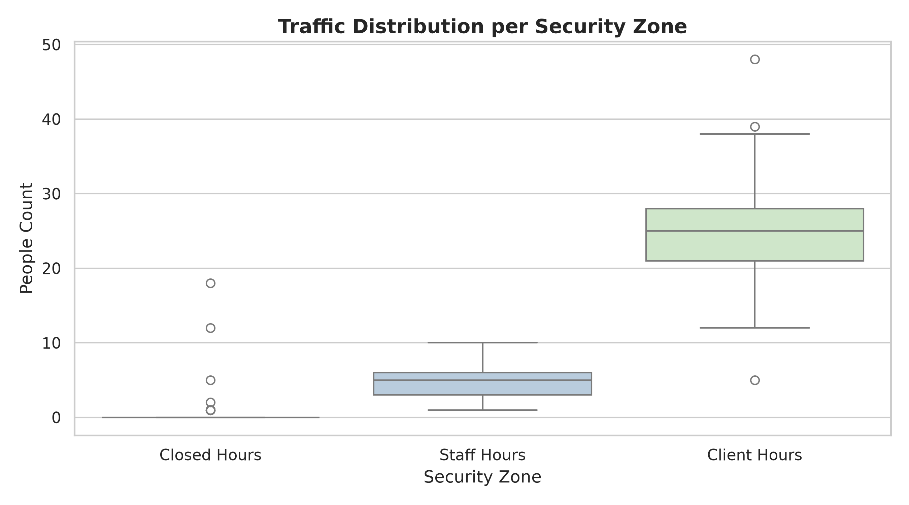
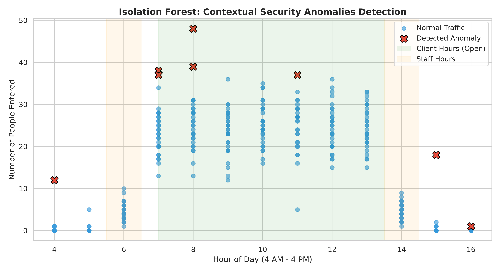

# Laboratory Work: AI-Enhanced Cybersecurity — Anomaly Detection

## 🏛️ Project Overview
This project demonstrates the implementation of an AI-enhanced physical security monitoring system for a bank branch. Instead of simple threshold rules, we use Machine Learning (`Isolation Forest`) to analyze human foot traffic and detect contextual security violations (e.g., unauthorized entries when the bank is closed).

---

## 📈 Business Logic & Scenario
Human activity in a bank fluctuates significantly depending on the time of day. This project simulates and analyzes a 30-day observation window (**4:00 AM to 4:00 PM**):
* **Client Hours (07:00 – 13:59) [Open]:** High, normal customer traffic averaging 25–35+ people per hour.
* **Staff Hours (06:00, 14:00) [Restricted]:** Low traffic restricted to authorized personnel (averaging 2–8 people).
* **Closed Hours (04:00–05:59, 15:00–16:00) [Locked]:** The facility is closed; baseline traffic must remain strictly at zero.

---

## 🔬 Methodology & Model
* **Algorithm:** Unsupervised `Isolation Forest` (from `scikit-learn`).
* **Concept:** Isolates observations by randomly splitting features. Anomalies require fewer splits because they are rare and distinct.
* **Contextual Detection:** Evaluates the interaction between the **hour of the day** and the **number of people** to flag suspicious behavior in restricted or locked time zones.

---

## 📊 Visual Analysis & Results

### 1. Bank Traffic Trend Across Operating Zones

* **Insight:** Demonstrates daily traffic curves, clearly separating deep closed hours, restricted staff windows, and high-volume client hours.

### 2. Statistical Distribution per Zone

* **Insight:** The boxplot visualization highlights the variance and median values within each security zone, capturing baseline behavior and statistical outliers.

### 3. Isolation Forest Anomaly Detection

* **Insight:** The scatter plot maps model decisions. Blue circles represent normal behavior, while red crossed markers ($\mathbf{X}$) accurately flag contextual security incidents (unauthorized early entries and post-closing breaches).

---

## 📂 Repository Structure

```text
Lab2/
│
├── generate_and_detect.py        # Main Python script for data generation and ML modeling
├── requirements.txt              # Project dependencies
├── README.md                     # Documentation and visual reports
├── raw_bank_traffic.csv          # Complete synthetic dataset (390 records)
├── detected_security_anomalies.csv # Filtered security incident log
├── chart_1_traffic_trend.png     # Traffic trend visualization
├── chart_2_distribution.png      # Statistical distribution boxplot
└── chart_3_isolation_forest.png  # Model anomaly detection scatter plot
